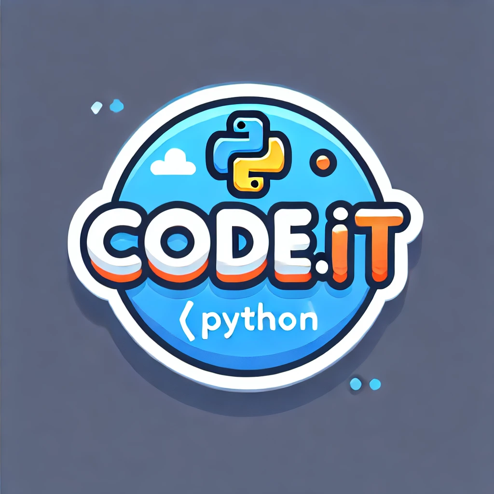

<p align="center">
  
</p>

<p align="center"><b>A coding studio built for ages 8 to 14. Kids describe a game, get a working first version, then change it and see the code behind every change.</b></p>

<p align="center">
  <a href="https://codeitlearn.com">codeitlearn.com</a> ·
  Capstone project, Sheridan College · Top 5 finalist out of 49 teams
</p>

---

## What it does

- **Build from an idea.** A child types one sentence ("a game where a ghost steals candy") and CodeIt builds a working first version. They change it with an editor that shows the code for every edit.
- **Check that they understood it.** After a build, the quiz is generated from the child's own project. The wrong answers are other real values from the same file, so a guess scores like a guess. Only a first-time right answer counts.
- **Learn Python with no AI involved.** Beginner Python lessons, from a first line to a game they build, and a Python playground that runs in the browser.
- **Games and rewards.** A robot puzzle, a platformer and character customisation, with progress and a leaderboard.
- **Families.** Parent accounts and progress for each child. It's free to start, and a family plan is CA$12 a month.

## How it's built

| Part | Stack |
|---|---|
| Frontend | React 18, React Router, CodeMirror 6 (Python and HTML editors), Testing Library |
| Backend | Node.js + Express, served as a Vercel function (`api/index.js`) |
| Data | PostgreSQL on Supabase, versioned SQL migrations in `supabase/migrations` |
| AI builds | Anthropic API, behind per-account monthly limits |
| Payments | Stripe (family plan) |
| Mobile | Capacitor iOS shell in `apps/ios` |
| Quality | 2,000+ automated tests (Jest and `node --test`) on every push via GitHub Actions, plus Playwright browser checks across devices, run on demand |

```
packages/
  gamified-elearning/     React app: studio, lessons, playground, games, parent area
  codeit-backend/         Express API: accounts, builds, quizzes, family plan
  robot-puzzle/           Puzzle game
  vertical-platformer-main/  Platformer game
  shared-auth/            Auth shared by the apps
api/                      Vercel entry points
supabase/migrations/      Database schema, in order
ops/                      Migrations runner and browser checks
apps/ios/                 iOS shell
```

## Run it locally

```bash
npm ci
npm run start:backend     # API on :8080 (needs DATABASE_URL, see packages/codeit-backend/.env.example)
npm run start:learning    # app on :3000
npm test                  # backend and frontend suites
```

## Notes

Design notes, plans and fix write-ups live in [`docs/`](docs) and [`docs/notes/`](docs/notes).

Built by [Mustafa AlQudah](https://mustafaalqudah.com).
